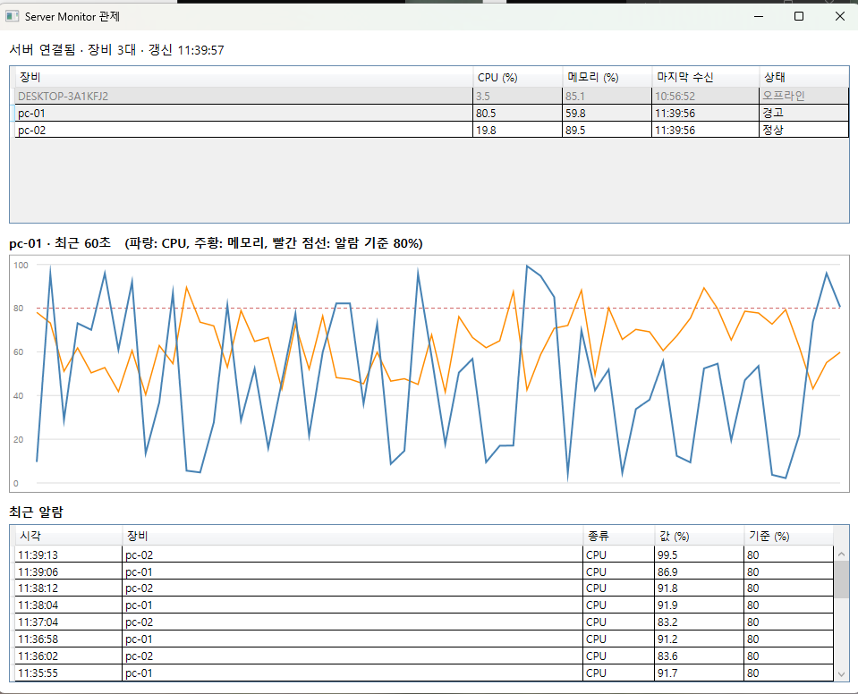

# Server Monitor


여러 PC·서버의 CPU/메모리 상태를 수집해 실시간으로 보여주고, 임계치를 넘으면 알람을 남기는 모니터링 플랫폼입니다.
에이전트가 지표를 수집해 서버로 보내고, 서버는 DB에 저장하면서 SignalR로 관제 화면에 즉시 밀어줍니다.



## 주요 기능

- **에이전트**: 1초 주기로 CPU/메모리를 측정해 서버로 전송. 시뮬레이션 모드(`sim`) 지원
- **네트워크 장애 대응**: 서버가 꺼져 있어도 1초 수집은 계속되고, 메모리 큐에 쌓았다가 복구되면 오래된 순서대로 재전송
- **API 키 인증**: 지표 수집 API(`POST /api/metrics`)는 `X-Api-Key` 헤더가 없거나 틀리면 401
- **실시간 푸시**: 폴링 대신 SignalR로 지표와 알람을 관제 화면에 즉시 전달
- **자동 재연결**: 서버가 재시작되면 관제 화면이 스스로 다시 연결하고 현재 상태를 다시 불러옴
- **알람**: CPU 80% 이상이면 알람 기록 (장비별 60초 쿨다운으로 중복 방지)
- **WPF 관제 화면**: 장비 목록(정상/경고/오프라인), 선택 장비의 최근 60초 그래프, 최근 알람 이력

## 구조

```
Agent (수집) --HTTP POST + API Key--> Server (ASP.NET Core + SQLite) --SignalR push--> Dashboard (WPF)
```

```
src/
  Agent/        지표 수집, 로컬 큐 버퍼링, 재전송
  Server/       Minimal API, SignalR Hub, SQLite 저장, 알람 판정
  Dashboard/    WPF 관제 화면 (MVVM)
    Models/       서버와 주고받는 데이터 형식
    Services/     MonitorClient: REST 조회 + SignalR 수신 + 자동 재연결
    ViewModels/   MainViewModel, DeviceRowViewModel: 화면 상태와 로직
    MainWindow    화면 모양과 그래프 그리기
```

## 기술 스택

C# / .NET 10, ASP.NET Core Minimal API, SignalR, SQLite (Microsoft.Data.Sqlite), WPF (MVVM)

## 실행 방법

요구 사항: Windows, .NET 10 SDK (CPU/메모리 실측은 Windows 성능 카운터를 사용하므로 Windows 전용)

```powershell
dotnet build

# (선택) API 키 지정. 서버와 에이전트가 같은 값을 써야 합니다. 기본값은 dev-secret-key
$env:MONITOR_API_KEY = "my-secret"

# 1) 서버
dotnet run --no-build --project src/Server --urls http://localhost:5000

# 2) 에이전트 (실제 측정은 장비 이름만, 시뮬레이션은 sim 추가)
dotnet run --no-build --project src/Agent -- pc-01 sim
dotnet run --no-build --project src/Agent -- pc-02 sim

# 3) 관제 화면
dotnet run --no-build --project src/Dashboard
```

서버, 에이전트, 관제 화면은 각각 별도 터미널에서 실행합니다. 서버를 껐다 켜도 에이전트는 수집을 이어가고, 관제 화면은 자동으로 다시 연결됩니다.

## Docker로 실행

```powershell
docker compose up -d --build
```

서버와 시뮬레이션 에이전트 2대(pc-01, pc-02)가 함께 뜹니다. 관제 화면은 윈도우에서 `dotnet run --no-build --project src/Dashboard`로 실행합니다. 컨테이너는 리눅스라 성능 카운터 실측은 불가능하고 시뮬레이션 모드만 동작합니다. 환경변수 `MONITOR_API_KEY`로 API 키를 바꿀 수 있습니다.
## API

| 메서드 | 경로 | 설명 |
|---|---|---|
| POST | /api/metrics | 에이전트가 지표 전송 (`X-Api-Key` 필요) |
| GET | /api/metrics?limit=10 | 최근 지표 조회 |
| GET | /api/devices | 장비별 최신 상태 |
| GET | /api/devices/{name}/history?limit=60 | 장비별 최근 기록 (그래프용) |
| GET | /api/alerts?limit=20 | 알람 이력 |
| WS | /hub/monitor | SignalR 허브. 이벤트: `MetricReceived`, `AlertRaised` |

## 성능 측정

부하 생성기(`src/LoadTest`)로 가상 에이전트 N대가 1초에 한 건씩 `POST /api/metrics`를 보내는 상황을 20초간 재현했습니다. 서버와 부하 생성기를 같은 PC(Windows)에서 실행했고, 단계마다 DB를 새로 만들어 측정했습니다.

```powershell
dotnet run -c Release --project src/LoadTest -- --agents 1000 --duration 20 --url http://127.0.0.1:5000
```

### 개선 전후

| 가상 에이전트 | 개선 전 | 개선 후 |
|---|---|---|
| 100대 | 86건/초 (목표 100), 평균 583ms | 미측정 |
| 500대 | 1건/초, 실패 9,888/10,000 | 미측정 |
| 1000대 | 0건/초, 전부 실패 | 1,000건/초, 평균 0.4ms, 실패 0 |
| 2000대 | 미측정 | 1,999건/초, 평균 0.5ms, p95 1.1ms, 실패 0 |
| 5000대 | 미측정 | 4,995건/초, 평균 0.8ms, p95 2.0ms, 실패 0 |

### 병목을 찾은 과정

| 단계 | 가설 | 결과 |
|---|---|---|
| WAL 모드 + `synchronous=NORMAL` (시도) | 쓰기마다 디스크 동기화가 병목 | 판단 불가로 결과에서 제외. 당시 측정이 Docker Desktop 경유라 편차가 컸고, 변경이 코드에 반영되었는지도 확인하지 못했습니다 |
| 요청마다 개별 INSERT를 큐 + 단일 쓰기 작업 + 배치 트랜잭션으로 변경 | 동기 DB 쓰기가 스레드를 막아 스레드 풀이 고갈됨 | 1000대에서 0건/초(전부 실패)가 1,000건/초(실패 0)로 개선 |
| ASP.NET Core 요청 로그를 Warning으로 변경 | 요청당 6줄의 콘솔 로그가 초당 약 1,000건에서 천장이 됨 | 2000대 884건/초가 1,999건/초로, 5000대 904건/초(실패 4,662)가 4,995건/초(실패 0)로 개선 |

### 측정의 한계

- 응답 시간은 "큐에 넣고 응답하기까지"입니다. 저장 완료 시점은 별도로 확인했습니다. 단계마다 부하 종료 후 API로 장비 수와 기록 수를 조회해 모든 지표가 DB에 들어간 것을 대조했습니다.
- 부하 생성기와 서버가 같은 PC에서 돌기 때문에 서버 단독 최대치가 아닙니다. 5000대에서도 실패가 0이므로 아직 한계에 도달한 것이 아닙니다.
- Windows의 Docker Desktop을 거친 측정은 같은 조건에서도 편차가 매우 커서(10대 평균 12ms가 393ms로 변동) 기준 수치에서 제외했습니다.
## 설계 메모와 한계

- 에이전트 큐는 메모리에만 있어서, 서버가 꺼진 상태에서 에이전트까지 종료하면 대기 중이던 지표는 사라집니다.
- GET API와 허브는 인증이 없습니다. 내부망 사용을 가정한 구성입니다.
- 알람 임계치(80%)와 쿨다운(60초)은 서버 코드의 상수입니다.
- 서버는 지표를 큐에 넣고 먼저 응답한 뒤 백그라운드에서 저장합니다. 서버가 비정상 종료되면 저장 전의 지표(최대 큐 용량 10만 건)가 유실될 수 있습니다. 큐가 가득 차면 503을 돌려주고, 에이전트는 이를 실패로 보고 자체 버퍼에 보관했다가 재전송합니다.
- Windows에서 Docker Desktop을 쓸 때 `localhost`가 IPv6로 먼저 연결을 시도하다 지연되는 문제가 있어, 에이전트와 관제 화면의 기본 주소를 `127.0.0.1`로 두었습니다.

## 앞으로의 계획

- [ ] 에이전트 버퍼를 디스크에 저장 (에이전트 재시작에도 보존)
- [ ] 장비별 등록 토큰 인증
- [ ] 서버 큐의 영속화 (재시작 시 유실 방지)
- [x] Docker Compose 배포, 부하 테스트 수치 측정
- [ ] AI 기반 이상 탐지
- [ ] 웹 대시보드

